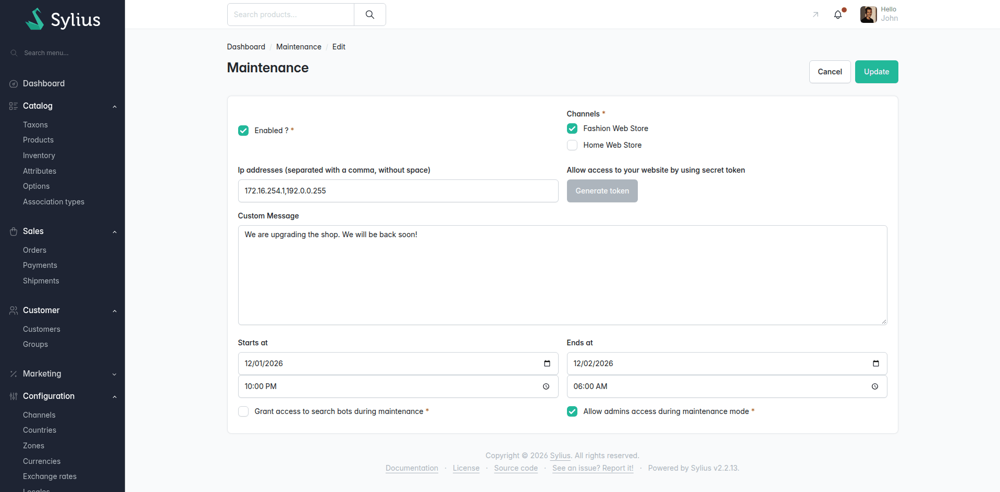

[](https://github.com/synolia/SyliusMaintenancePlugin/blob/main/LICENSE)
[](https://github.com/synolia/SyliusMaintenancePlugin/actions/workflows/analysis.yaml)
[](https://github.com/synolia/SyliusMaintenancePlugin/actions/workflows/sylius.yaml)
[](https://packagist.org/packages/synolia/sylius-maintenance-plugin)
[](https://packagist.org/packages/synolia/sylius-maintenance-plugin)

<p align="center">
    <a href="https://sylius.com" target="_blank">
        <picture>
            <source media="(prefers-color-scheme: dark)" srcset="https://media.sylius.com/sylius-logo-800-dark.png">
            <source media="(prefers-color-scheme: light)" srcset="https://media.sylius.com/sylius-logo-800.png">
            
        </picture>
    </a>
</p>

<h1 align="center">Sylius Maintenance Plugin</h1>

## Features

When your website is under maintenance, the plugin lets you:

* Show a maintenance page (HTTP 503) instead of your shop, with a custom message if you want one.
* Let some IP addresses, or anyone holding a secret token, browse the shop as usual.
* Let search bots through, to avoid a negative impact on SEO.
* Keep the admin area available, or close it too.
* Put only some channels under maintenance on a multi-channel store.
* Schedule the maintenance with a start date, an end date, or both.
* Turn the maintenance on and off from the console or from the Sylius back-office.



## Requirements

|         | Version                    |
|:--------|:---------------------------|
| PHP     | ^8.3                       |
| Sylius  | ^2.2                       |
| Symfony | ^6.4 \|\| ^7.4 \|\| ^8.0 |

## Installation

1. Add the bundle and dependencies in your composer.json :

    ``` shell   
    composer require synolia/sylius-maintenance-plugin
    ```

2. Import routing in your `config/routes.yaml` file:

    ``` yaml   
    synolia_maintenance:
        resource: "@SynoliaSyliusMaintenancePlugin/config/routes/admin_routing.yaml"
        prefix: '/%sylius_admin.path_name%'
    ```

3. Import twig hooks from config in your `config/packages/maintenance.yaml` file:

    ``` yaml   
    imports:
         - { resource: "@SynoliaSyliusMaintenancePlugin/config/config.yaml" }
    ```

4. Clear cache

    ``` shell
    php bin/console cache:clear
    ```

## Usage

The maintenance is driven by a **maintenance.yaml** file at the root of your project.
While this file exists, the website is under maintenance, unless it contains `enabled: false`.
You can write it by hand, or let the console commands and the back-office write it for you.

> [!WARNING]
> On a store with **several channels**, a **maintenance.yaml** without `channels` puts **no channel** under maintenance.
> List the channels to put under maintenance, or use `maintenance:enable`, which lists all of them for you.

### Configuration file

Every key is optional:

```yaml
# maintenance.yaml
enabled: true                          # false keeps the configuration without putting the website under maintenance
ips: [172.16.254.1, 192.0.0.255]       # IP addresses allowed to browse the shop
channels: [FASHION_WEB]                # multi-channel stores only, see below
scheduler:
    start_date: '2026-12-01 22:00:00'  # format Y-m-d H:i:s
    end_date: '2026-12-02 06:00:00'
custom_message: '<p>We are back soon!</p>'  # HTML is allowed, replaces the default message
token: 'a-long-random-secret'          # see "Access token" below
allow_bots: true                       # default: false
allow_admins: false                    # default: true
```

On a store with **several channels**, only the channels listed in `channels` are under maintenance:
a file without `channels` puts no channel under maintenance (see the warning above). With a single channel, `channels` is ignored.

### Console commands

```shell
# Put all channels under maintenance and keep the admin area open.
# The IP addresses, message, token and schedule already configured are kept.
php bin/console maintenance:enable

# Same, and allow some IP addresses (separated with a space)
php bin/console maintenance:enable 172.16.254.1 255.255.255.255 192.0.0.255

# Same, and close the admin area too
php bin/console maintenance:enable --disable-admin

# Turn the maintenance off, keeping the configuration for next time
php bin/console maintenance:disable

# Turn the maintenance off and remove the configuration file
php bin/console maintenance:disable --clear
```

### Back-office

The configuration page is in **Configuration > Maintenance**. From there you can:

- enable or disable the maintenance;
- choose the channels under maintenance (multi-channel stores only);
- allow IP addresses;
- write a custom message;
- set a start date and an end date;
- let search bots and admins through;
- store the secret token in your session, to browse the shop during the maintenance.

A secret token is generated when the back-office or `maintenance:enable` creates the **maintenance.yaml** file.
A file written by hand has no token unless you add a `token` key.

### Access token

When a token is configured, a request bypasses the maintenance if it carries the token:

- as a query parameter: `?synolia_maintenance_token=<token>`;
- as a `synolia_maintenance_token` header;
- in the session, using the button of the back-office page.

Without a configured token, no request can bypass the maintenance this way.

### What visitors get

- HTML requests get the maintenance page with a 503 status, including on URLs that do not exist.
- Requests sent with a JSON `Content-Type` get a 503 response: `{"key": "maintenance", "message": "<custom message>"}`.
- The Symfony profiler (`/_profiler`, `/_wdt`) stays reachable.

### Customize the maintenance page

Override the template in `templates/bundles/SynoliaSyliusMaintenancePlugin/maintenance.html.twig`.
It receives `custom_message`, an empty string when no custom message is set.

To translate the page, use translation keys in your template. The default message uses the `maintenance.ui.message` key.
The page is translated with the locale of the requested URL. On a URL that does not exist, that locale is unknown,
so you may prefer the language of the browser:

```twig

{{ 'maintenance.ui.message'|trans({}, 'messages', locale) }}
```

### Maintenance file in another directory

Set the directory, relative to your project root, in your `.env`:

```dotenv
SYNOLIA_MAINTENANCE_DIR=var/maintenance
```

### Cache the configuration file

```dotenv
# .env
SYNOLIA_MAINTENANCE_CACHE=30 # ttl in seconds
```

Then configure the `synolia_maintenance.cache` pool, for example with Redis:

```yaml
# config/packages/prod/cache.yaml
framework:
    cache:
        pools:
            synolia_maintenance.cache:
                adapter: cache.adapter.redis
```

The console commands and the back-office clear this cache when they change the configuration.

### Add your own rule

Each rule is a checker implementing `Synolia\SyliusMaintenancePlugin\Checker\IsMaintenanceCheckerInterface`.
Checkers are registered automatically and run by decreasing priority. As soon as one of them returns
`IsMaintenanceVoterInterface::ACCESS_GRANTED`, the request is let through. Return `IsMaintenanceVoterInterface::ACCESS_DENIED`
to let the next checkers decide.

```php
use Symfony\Component\HttpFoundation\Request;
use Synolia\SyliusMaintenancePlugin\Checker\IsMaintenanceCheckerInterface;
use Synolia\SyliusMaintenancePlugin\Model\MaintenanceConfiguration;
use Synolia\SyliusMaintenancePlugin\Voter\IsMaintenanceVoterInterface;

final class HealthCheckChecker implements IsMaintenanceCheckerInterface
{
    public static function getDefaultPriority(): int
    {
        return 95;
    }

    public function isMaintenance(MaintenanceConfiguration $configuration, Request $request): bool
    {
        return '/health' === $request->getPathInfo()
            ? IsMaintenanceVoterInterface::ACCESS_GRANTED
            : IsMaintenanceVoterInterface::ACCESS_DENIED;
    }
}
```

The built-in checkers have the following priorities: enabled (100), IP addresses and bots (90), schedule (80),
admin area (70), channels (60), profiler (30) and token (20).

## Development

The plugin is developed and tested with the [Sylius Test Application](https://github.com/Sylius/TestApplication):

```shell
make install    # optionally: make install SYLIUS_VERSION=2.3.0 SYMFONY_VERSION=7.4
make phpunit
make serve      # Symfony local web server on the test application
```

Use `vendor/bin/console` to run Symfony commands against the test application.

See [How to contribute](CONTRIBUTING.md) for more details (database configuration, versions, ...).

## License

This library is under the [EUPL-1.2 license](LICENSE).

## Credits

Developed by [Synolia](https://synolia.com/).
